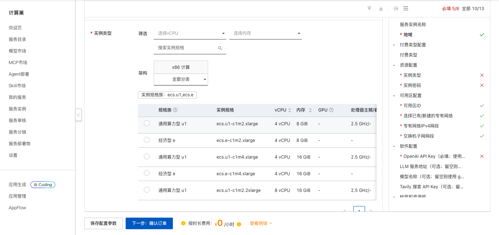
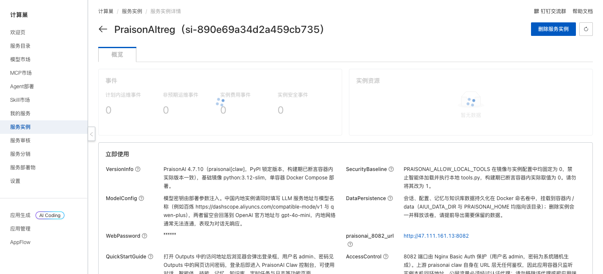
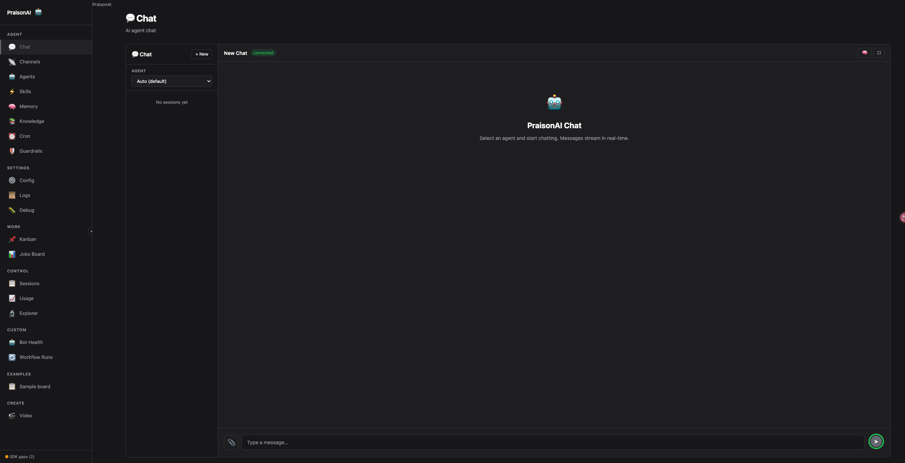

# PraisonAI 部署文档

## 概述

PraisonAI 是一个开源的多智能体编排框架，提供对话、智能体、技能、记忆、知识库、定时任务和日志等功能。本方案通过 Docker Compose 在一台云服务器 ECS 上部署 PraisonAI Claw 控制台，适合功能体验和开发测试。

## 部署流程

### 1. 创建服务实例

访问 [PraisonAI 部署链接](https://computenest.console.aliyun.com/service/instance/create/cn-hangzhou?type=user&ServiceId=service-3fe8800bc3fd4d9cb766)，按页面提示填写部署参数。

主要参数如下：

| 参数 | 说明 |
| --- | --- |
| 服务实例名称 | 长度不超过 64 个字符，以英文字母开头 |
| 地域、可用区 | ECS 部署位置，建议选择离使用者较近的地域 |
| 付费类型 | 支持按量付费和包年包月，具体以页面为准 |
| 实例类型 | PraisonAI 所在 ECS 的规格 |
| 实例密码 | ECS 登录密码，请按页面密码复杂度要求填写 |
| OpenAI API Key | OpenAI 兼容接口的访问密钥 |
| LLM 服务地址 | OpenAI 兼容接口地址；使用百炼时可填写 `https://dashscope.aliyuncs.com/compatible-mode/v1` |
| LLM 模型名称 | 接口支持的模型名；使用百炼时可填写 `qwen-plus` |
| Tavily API Key | 可选，启用相关联网搜索能力时填写 |

### 2. 确认订单并创建

参数填写完成后，单击 **下一步：确认订单**。确认资源和费用，阅读并同意服务协议，然后单击 **立即创建**。

### 3. 等待部署完成

提交成功后进入服务实例列表。待实例状态变为 **已部署**，打开实例详情。通常需要等待数分钟。

### 4. 访问服务

在实例详情页的 **立即使用** 区域获取 PraisonAI 地址和网页访问密码。打开地址后，在浏览器认证窗口中输入用户名 `admin` 和对应密码，即可进入 PraisonAI Dashboard。

## 使用说明

进入 Dashboard 后，可使用以下功能：

- 在 **Chat** 中选择智能体并创建对话。
- 在 **Agents**、**Skills** 中管理智能体和技能。
- 在 **Memory**、**Knowledge** 中维护记忆和知识库。
- 在 **Cron** 中配置定时任务。
- 在 **Logs**、**Debug** 中查看运行日志并排查问题。

如果对话没有响应，请先确认 API Key、LLM 服务地址和模型名称相互匹配，并检查所选模型是否已开通。

## 数据与安全

- 会话、配置、记忆和知识库数据保存在 Docker 命名卷中。删除服务实例会释放相关资源，请提前导出需要保留的数据。
- PraisonAI 应用端口不应直接暴露到公网，请保留部署方案提供的 Nginx 认证代理。
- 请妥善保管 ECS 密码、模型 API Key 和网页访问密码，避免在日志或公开仓库中泄露。

## 资源释放

不再使用时，在计算巢控制台删除服务实例，并确认关联的 ROS 栈、ECS、VPC 等资源均已释放，避免继续产生费用。

## 官方文档

- [PraisonAI 官方文档](https://docs.praison.ai/)
- [PraisonAI GitHub 仓库](https://github.com/MervinPraison/PraisonAI)
